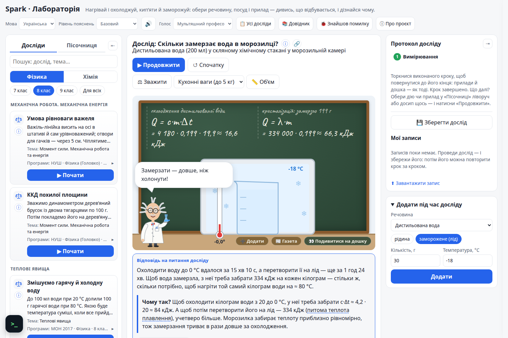
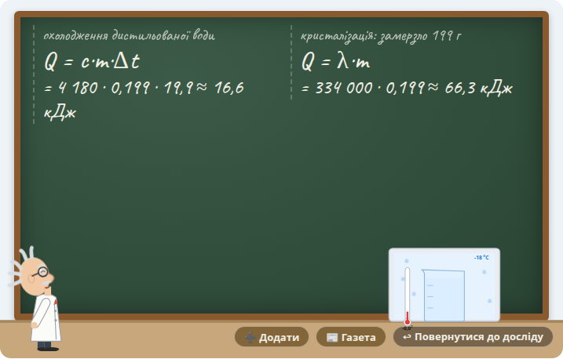
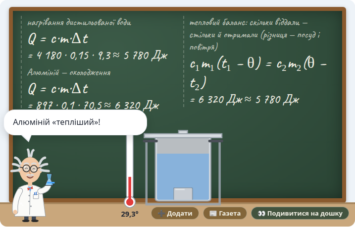
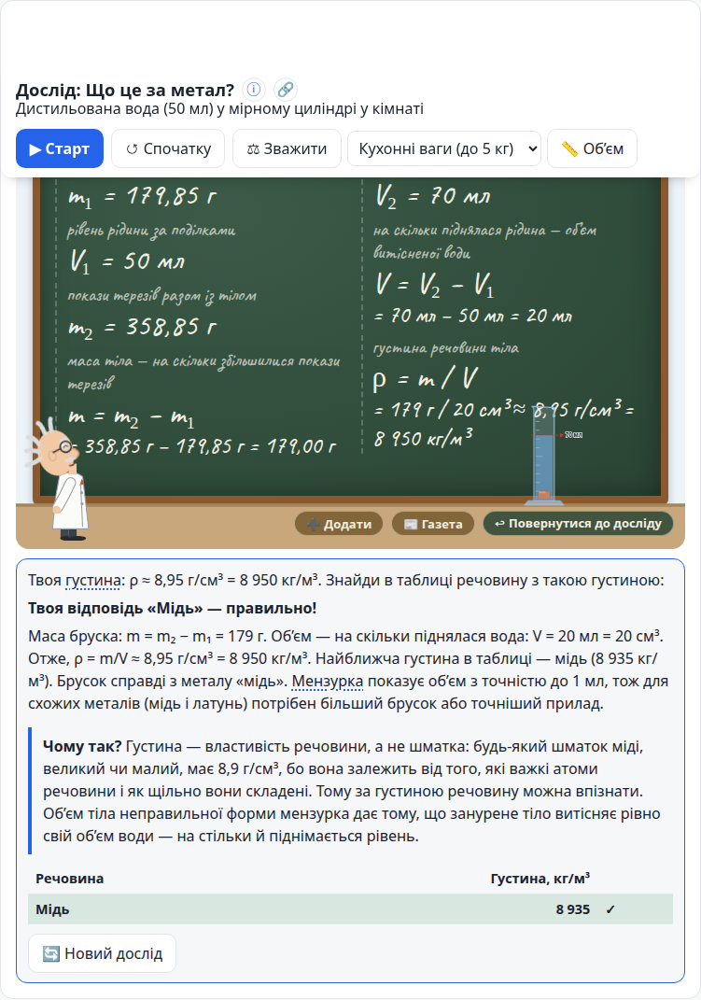
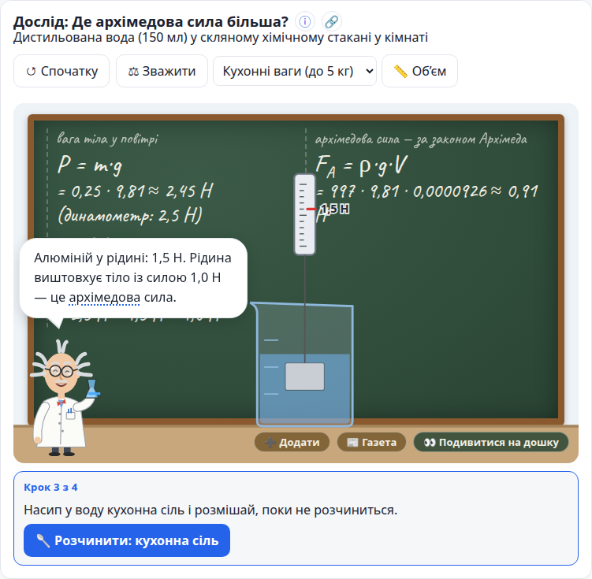
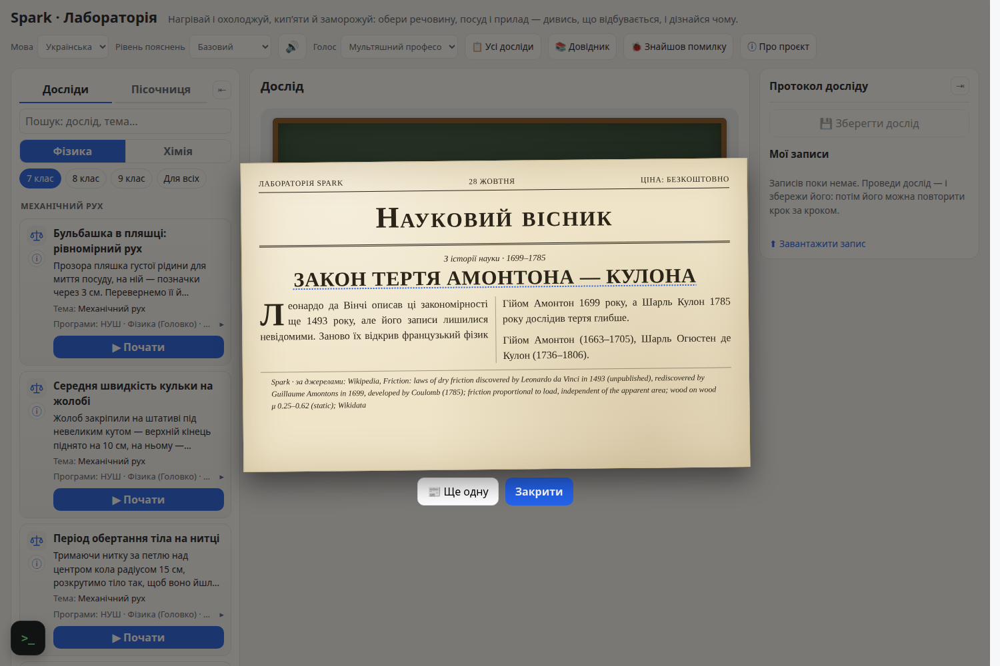
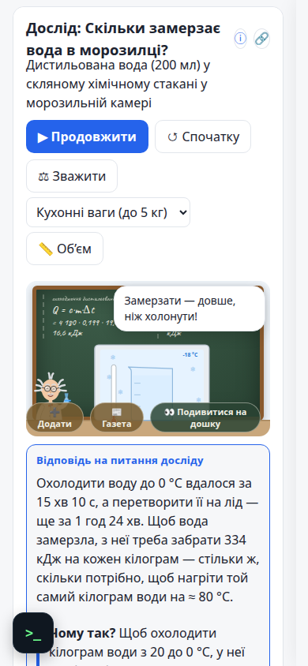
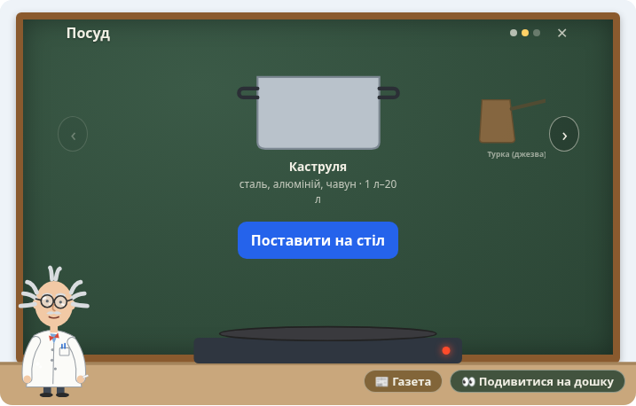
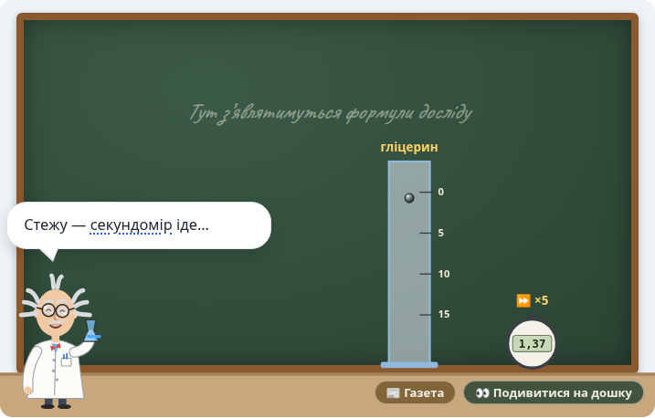

# Spark

Ядро научной лаборатории-песочницы для школьников (начинаем с физики): ученик сам ставит опыт, при желании — прогноз или цель, и получает честный разбор результата.
UI-независимый TypeScript-движок: работает в Node, браузере и Web Worker.

## Як це виглядає



| | |
|---|---|
|  |  |
| Професор читає дошку | Тепловий баланс у калориметрі |
|  |  |
| Густина невідомого металу | Архімедова сила |
|  |  |
| «До речі!..» — газета Професора | На телефоні |
|  |  |
| Пісочниця: обираємо над столом — і ставимо | Кулька в рідинах різної густини |

## Лабораторія в браузері

**Варіант 1 — для розробки** (зміни в коді видно одразу):

```bash
npm install
npm run web        # браузер відкриється сам на http://127.0.0.1:5173 ; зупинити — Ctrl+C
```

Сторінка працює, лише поки в терміналі запущено `npm run web`.

**Варіант 2 — один файл** (можна відкрити подвійним клацанням або надіслати учням):

```bash
npm run web:offline  # створить dist-offline/index.html — один самодостатній файл
```

**Варіант 3 — сайт** (для хостингу: сторінка кожного досліду, каталог, мета-теги для пошуку й поширення):

```bash
SPARK_SITE_URL=https://адреса.сайту npm run web:build  # створить dist-web/: 100 сторінок, sitemap.xml, robots.txt
```

Без `SPARK_SITE_URL` сайт теж збереться, але без `sitemap.xml`, `canonical` і `og:url`: їм потрібна повна адреса. Сайт може лежати й у підпапці (наприклад, на GitHub Pages).

Відкривати сам файл `web/index.html` не можна: це вихідний код, браузер його не виконає.

## Консоль

```bash
npm install
npm test        # vitest: физика проверяется против аналитических решений
npm run demo    # консольное демо: закипание чайника
npm run experiment -- --level school --lang uk   # дослід з поясненням: novice|school|advanced|expert|all, uk|en
npm run lab -- --goal 40 --pot glass                    # лаборатория: смешивание воды, прогноз/цель по желанию
npm run knowledge:report               # насколько надёжны данные
npm run typecheck
```

```ts
import { createSimulation, seconds } from './src/core/index.js';
import { createThermalSolver } from './src/domains/thermal/index.js';
import { kettleScenario } from './src/scenarios/index.js';

const sim = createSimulation({ solvers: [createThermalSolver()], fixedDt: seconds(0.1) });
const after60s = sim.run(kettleScenario(), seconds(60));
```

Архитектура и план — [docs/ARCHITECTURE.md](docs/ARCHITECTURE.md). Откуда берутся данные — [docs/DATA_POLICY.md](docs/DATA_POLICY.md) (`npm run knowledge:report`).
